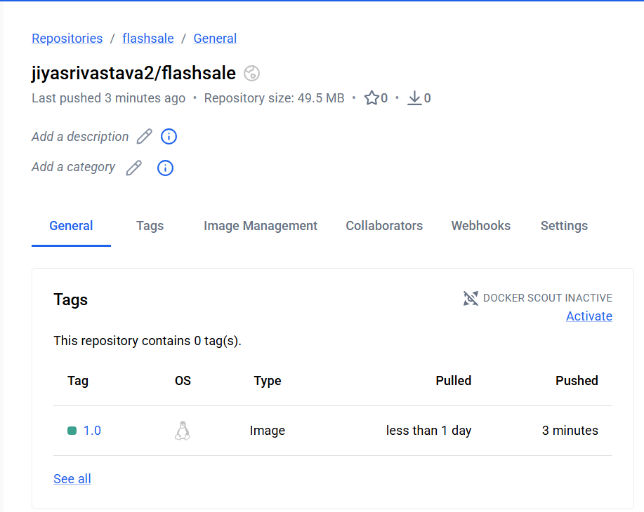

# Exercise 3: Flask Flash Sale Application Using Kubernetes ReplicaSet

## Objective

To containerize a Flask Flash Sale application using Docker and deploy it on Minikube using a Kubernetes ReplicaSet and Service. This exercise demonstrates scaling, automatic Pod replacement, and application access through a Kubernetes Service.

## Technologies Used

- Python
- Flask
- Docker
- Kubernetes
- Minikube
- kubectl
- Docker Hub

## Project Structure

```text
Exercise-03-Flask-ReplicaSet/
├── app.py
├── Dockerfile
├── flashsale-replicaset.yaml
├── image.png.png
├── Screenshot 2026-10-17 194602.png
├── Screenshot 2026-10-17 195055.png
└── README.md
```

## Steps of Execution

### 1. Build the Docker Image

Create the `app.py` file and a Dockerfile for the Flask application.

```bash
docker build -t flashsale:1.0 .
```

This builds the Docker image for the Flash Sale application.

### 2. Start Minikube

```bash
minikube start --driver=docker
```

This starts a local Kubernetes cluster using Docker as the driver.

### 3. Load the Docker Image into Minikube

```bash
minikube image load flashsale:1.0
```

This makes the locally built image available to the Minikube cluster.

### 4. Create the ReplicaSet and Service

Create the Kubernetes configuration file containing the ReplicaSet and Service resources.

Apply the configuration:

```bash
kubectl apply -f flashsale-replicaset.yaml
```

Expected output:

```text
replicaset.apps/flashsale-rs created
service/flashsale-svc created
```

### 5. Verify the Initial Pods

```bash
kubectl get pods
```

Initially, the ReplicaSet creates three Pods. Verify that the Pods reach the `Running` state and are ready.

### 6. Scale the ReplicaSet from Three to Five Pods

```bash
kubectl scale rs flashsale-rs --replicas=5
```

Expected output:

```text
replicaset.apps/flashsale-rs scaled
```

Verify the ReplicaSet:

```bash
kubectl get rs
```

Expected result: the desired, current, and ready replica counts should reach `5`.

### 7. Verify the Five Pods

```bash
kubectl get pods
```

Five Pods should be running after the ReplicaSet scales to five replicas.

### 8. Test Automatic Pod Replacement

Delete one of the existing Pods. Replace the example Pod name with an actual name from your `kubectl get pods` output.

```bash
kubectl delete pod <POD_NAME>
```

Verify the Pods again:

```bash
kubectl get pods
```

The ReplicaSet should create a replacement Pod to maintain the desired replica count of five.

### 9. View Pod IP Addresses and Node Assignments

```bash
kubectl get pods -o wide
```

This displays Pod IP addresses and the nodes on which the Pods are running. In a single-node Minikube cluster, all five Pods may run on the same node.

### 10. Access the Flask Application

```bash
minikube service flashsale-svc --url
```

Open the URL returned by Minikube in a browser.

The application provides these endpoints:

- `/` — Displays a welcome message and the serving Pod name.
- `/buy` — Simulates a flash-sale purchase.
- `/health` — Returns the health status of the application.

## Docker Hub (Optional)

The image was built and loaded locally into Minikube. If publishing it to Docker Hub is required, sign in:

```bash
docker login
```

Tag the image using your Docker Hub username:

```bash
docker tag flashsale:1.0 <YOUR_DOCKERHUB_USERNAME>/flashsale:1.0
```

Push the image:

```bash
docker push <YOUR_DOCKERHUB_USERNAME>/flashsale:1.0
```

Replace `<YOUR_DOCKERHUB_USERNAME>` with your Docker Hub username. Only add a Docker Hub repository screenshot if you have actually published the image.

## Screenshots

### 1. Docker Image or Repository Evidence



### 2. Kubernetes Deployment Evidence


### 3. ReplicaSet and Pod Verification


## Key Learnings

- A ReplicaSet maintains the desired number of Pods.
- Scaling from three to five replicas creates two additional Pods.
- Kubernetes automatically replaces a deleted Pod.
- `kubectl get pods -o wide` displays Pod IP addresses and node assignments.
- A Kubernetes Service provides an endpoint to access the application.
- Multiple Pods can run on a single Kubernetes node.

## Conclusion

The Flask Flash Sale application was containerized using Docker and deployed on Minikube using a Kubernetes ReplicaSet. The exercise demonstrates scaling from three to five Pods, automatic Pod replacement, and access through a Kubernetes Service.
