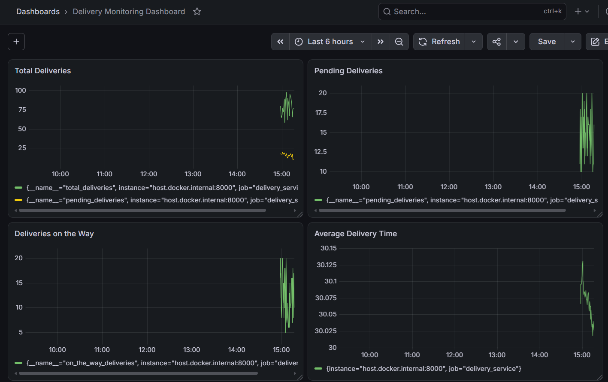

# Exercise 6: Real-Time Operations Monitoring and Alerting

## Objective

Build a real-time delivery monitoring system using Python, Prometheus, and Grafana, with alert rules and a Jenkins pipeline definition.

## Project Structure

- `delivery_monitoring/delivery_metrics.py` — generates simulated delivery metrics.

- `delivery_monitoring/Dockerfile` — defines the Docker image for the metrics application.

- `delivery_monitoring/prometheus.yml` — configures Prometheus scraping and alert rules.

- `delivery_monitoring/alert_rules.yml` — defines delivery monitoring alerts.

- `delivery_monitoring/Jenkinsfile` — defines the Jenkins pipeline.

## Metrics

- `total_deliveries`

- `pending_deliveries`

- `on_the_way_deliveries`

- Average delivery time, calculated from the summary metrics.

## Alert Rules

- **HighPendingDeliveries:** triggers when pending deliveries exceed 10 for 15 seconds.

- **HighAverageDeliveryTime:** triggers when average delivery time exceeds 30 seconds for 15 seconds.

## Verification

- Prometheus targets show the delivery service and Prometheus as UP.

- Both delivery alert rules were observed in the FIRING state.

- Grafana is connected to Prometheus.

- The Grafana dashboard contains panels for Total Deliveries, Pending Deliveries, Deliveries on the Way, and Average Delivery Time.

## Evidence

Add screenshots of:

1\. Prometheus targets showing both targets UP.

2\. Prometheus alerts showing the delivery alerts.

3\. Grafana dashboard showing all four metric panels.

## Note

The Jenkinsfile is defined, but the Jenkins pipeline still needs to be run and verified.

## Screenshots and Evidence

### image

### Screenshot 2026-10-18 153349

### Screenshot 2026-10-18 153456

