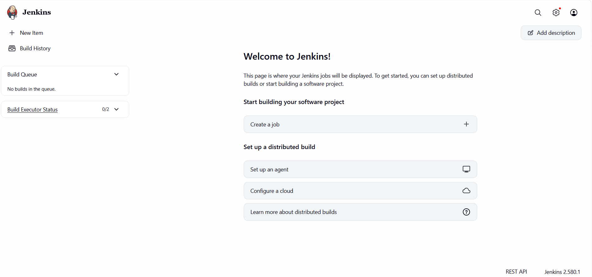
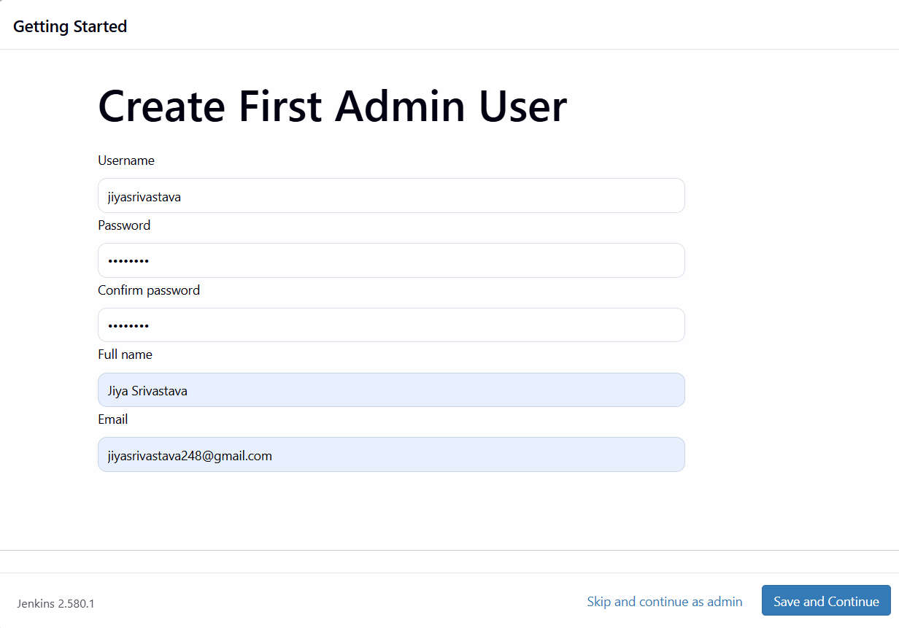
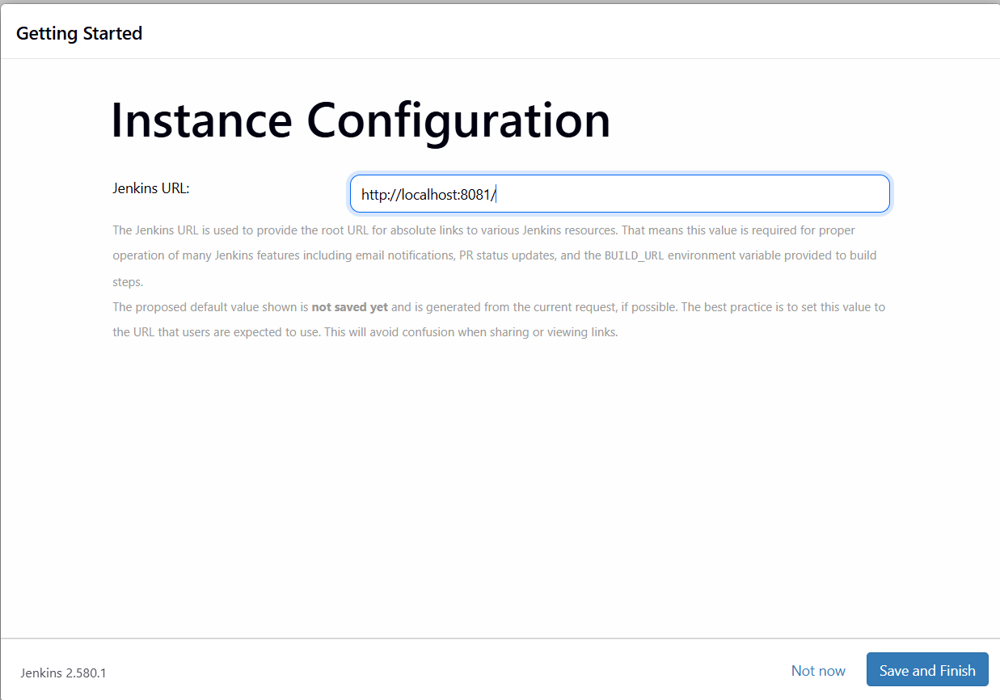
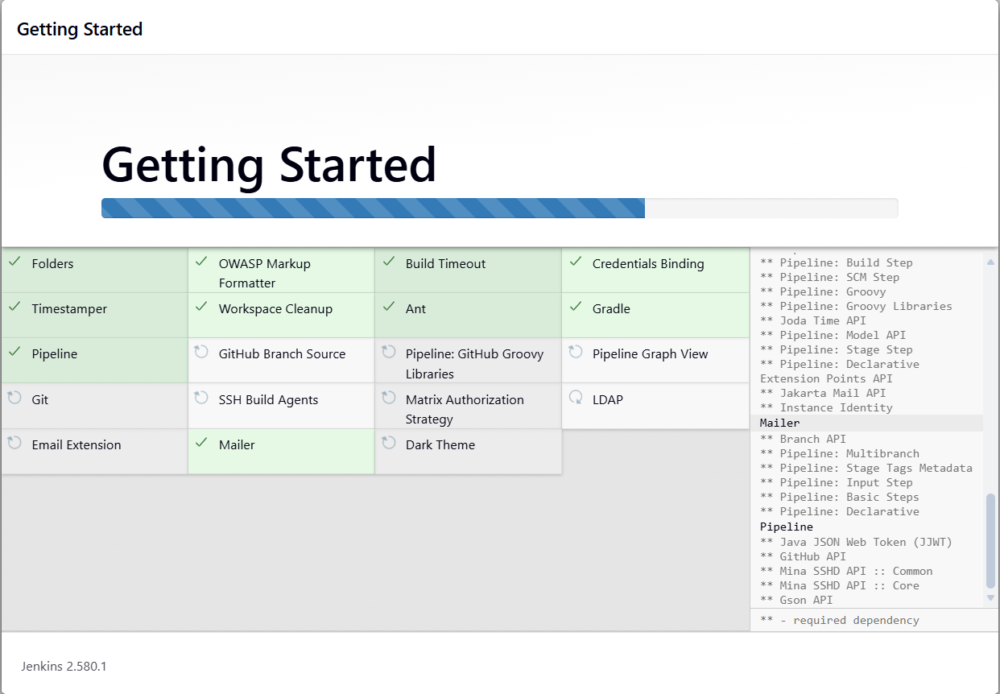

# Exercise 7 - Jenkins Installation

## Objective
Understand Continuous Integration (CI) and verify Jenkins.

## CI Overview
Continuous Integration integrates code changes into a shared repository and validates them through automated builds and tests.

## Jenkins Verification
- Docker image: jenkins/jenkins:lts
- Container status: running
- Jenkins URL: http://localhost:8081
- Java runtime: OpenJDK 21 LTS
- Existing pipeline: Delivery-Monitoring-Pipeline
- Successful build observed: #7

## Verification Commands
```powershell
docker ps --filter "name=jenkins"
docker exec jenkins java -version
docker inspect jenkins
```

## Conclusion
Jenkins was verified successfully. The existing container and pipeline were preserved.


## Screenshots and Evidence

### image1



### image2



### image3



### image4




